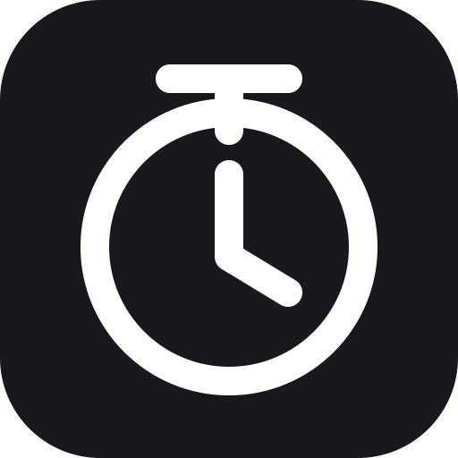

# Mini Timer



[中文](README.md) · [GitHub](https://github.com/michael-chow-arch/mini-timer) · [Releases](https://github.com/michael-chow-arch/mini-timer/releases)

A free, clean floating timer for PowerPoint presentations. Track your speaking time in a small draggable window, visible to the audience, without a second display.

## Preview


A dark translucent floating bar with only the time, start/pause, and reset controls.

## Features

- A draggable, always-on-top window; default size is `260 × 60` px and its position is remembered.
- Forward elapsed-time tracking with a monotonic clock; start, pause/resume, and reset.
- `MM:SS` display that switches to `HH:MM:SS` after one hour.
- Menu bar controls on macOS (the app is hidden from the Dock by default) and a system tray on Windows.
- Fully offline: no account, network service, advertising, or telemetry.
- Elapsed-time tracking only; no countdown or overtime alerts in this version.

## Install

### macOS 13+

Download the matching DMG from [Releases](https://github.com/michael-chow-arch/mini-timer/releases): `arm64` for Apple Silicon or `x64` for Intel Macs. Open the DMG, drag `Mini Timer.app` to Applications, then launch it there.

Use the monochrome stopwatch in the top menu bar to show, hide, or quit the app. It does not appear in the Dock by default. Current packages are unsigned and not notarized; macOS may warn that the developer cannot be verified.

### Windows 10 / 11 (x64)

The Windows NSIS installer is configured, but it has not yet been verified on physical Windows hardware or published. A verified installer will be available from [Releases](https://github.com/michael-chow-arch/mini-timer/releases); after launch, use the notification-area tray icon to show, hide, or quit it.

## Use

1. The timer starts at the upper-right of the primary screen. Drag its empty area to reposition it.
2. Select the round play/pause icon to control the timer; select the reset arrow to return to `00:00`.
3. Shortcuts work only while the floating window is focused: `Space` start/pause, `R` reset, and `Esc` hide the window without quitting.
4. Use the menu bar or system tray to show the window again, or quit the app.

## Presentation-mode compatibility

Overlay visibility has been tested during full-screen PowerPoint playback and slide changes on macOS. Real-world presentation testing on Windows is still pending. Exclusive full-screen modes and secure desktops may prevent overlays; rehearse on your actual equipment before a presentation.

## Development

Node.js 22 or newer is required. After cloning:

```bash
npm install
npm run dev
npm test
npm run check
```

Build installers on their respective operating systems:

```bash
npm run dist:mac:arm64  # Apple Silicon macOS
npm run dist:mac:x64    # Intel macOS
npm run dist:win        # Windows x64, pending hardware verification
```

The app uses a blue-and-white stopwatch icon. After updating `assets/icon.svg` or `assets/tray-icon.svg`, run `node scripts/generate-icons.mjs` to regenerate platform assets. The script needs `rsvg-convert`, and on macOS the included `iconutil` utility.

## License

[MIT License](LICENSE). [Report a problem](https://github.com/michael-chow-arch/mini-timer/issues) or see [contribution guidelines](CONTRIBUTING.md).
