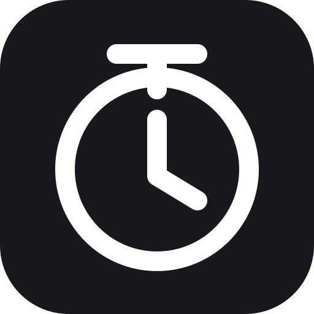

# Mini Timer



[English](README.en.md) · [GitHub](https://github.com/michael-chow-arch/mini-timer) · [Releases](https://github.com/michael-chow-arch/mini-timer/releases)

免费、纯净的 PPT 悬浮计时助手。无需扩展屏幕，用一个可拖动的小窗查看演讲用时，观众也能看到。

## 预览


## 功能

- 默认 `260 × 72` px，可拖动、始终置顶，并记住上次窗口位置。
- 顶部「正计时 / 倒计时」Tab 直接切换，白底加粗文字标明当前模式。
- 正向计时；开始、暂停后续计，重置归零。
- 倒计时：默认 5 分钟，可直接输入分钟数，也支持 `MM:SS` 或 `HH:MM:SS`；支持暂停续计、重置为设定时长。
- `MM:SS` 显示，超过一小时自动切换为 `HH:MM:SS`。
- macOS 从菜单栏操作（应用默认不显示在 Dock）；Windows 从系统托盘操作。
- 完全离线：无需注册、无需网络服务，不含广告或遥测。
- 倒计时到零自动停止，保留白色数字，以「时间到」文字安静提醒，不播放声音或弹窗。

## 安装

### macOS 13+

在 [Releases](https://github.com/michael-chow-arch/mini-timer/releases) 下载与芯片匹配的 DMG：Apple Silicon 选择 `arm64`，Intel 选择 `x64`。打开 DMG 后将 `Mini Timer.app` 拖到「应用程序」文件夹，再从中启动。

启动后，可通过屏幕顶部菜单栏显示、隐藏或退出应用。应用默认不会出现在 Dock 中。当前安装包未做开发者签名或 Apple 公证，macOS 可能提示无法验证开发者。

### Windows 10 / 11（x64）

在 [Releases](https://github.com/michael-chow-arch/mini-timer/releases) 选择：

- **绿色免安装版**：下载以 `win-x64-portable.exe` 结尾的文件，双击运行。
- **安装版**：下载以 `win-x64-setup.exe` 结尾的文件，按向导安装。

启动后可通过系统托盘显示、隐藏或退出应用。当前程序未签名，Windows 可能显示 SmartScreen 提示。

## 使用

1. 启动后，计时器默认出现在主屏幕右上角；拖动空白区域可移动它。
2. 点击开始/暂停按钮控制计时，点击重置按钮归零为 `00:00`。
3. 点击顶部「倒计时」Tab，再点击带边框的「设置时长」按钮，输入 `5` 就是 5 分钟。按 `Enter` 保存，再按 `Space` 开始；`Esc` 或「取消」放弃修改。需要精确到秒时可输入 `02:30`，也支持 `01:30:00`；范围为 1 秒至 `99:59:59`。
4. 随时点击另一个 Tab 切换模式，当前计时会停止并重置。切回正计时从 `00:00` 开始，切回倒计时恢复设定时长，按开始后重新计时。重复点击当前 Tab 不影响计时。运行中设置时长需先暂停；修改时长后需手动开始。本次启动期间保留设定时长，退出应用后恢复默认。
5. 只有悬浮窗获得焦点时，快捷键才生效：`Space` 开始/暂停，`R` 重置，`Esc` 隐藏窗口但不退出应用。聚焦模式 Tab 时可用左右方向键切换，`Home` / `End` 选择正计时 / 倒计时；聚焦模式或时长按钮时，`Space` 操作该按钮。编辑时长时不会触发计时快捷键。
6. 通过菜单栏或系统托盘可再次显示窗口，或彻底退出应用。隐藏窗口不会暂停计时；倒计时结束的提醒会在重新显示窗口时可见。

## 演示模式兼容性

已在 macOS 和 Windows 11 的 PowerPoint 全屏播放和翻页时验证悬浮显示。Windows 11 POC 还验证了演示者视图、空格/方向键翻页，以及倒计时结束后不抢焦点。独占全屏、安全桌面等特殊模式可能阻止窗口覆盖，正式演讲前请在实际设备上试放。

## 开发

需要 Node.js 22 或更高版本。克隆后运行：

```bash
npm install
npm run dev
npm test
npm run check
```

在对应操作系统构建安装包：

```bash
npm run dist:mac:arm64  # Apple Silicon macOS
npm run dist:mac:x64    # Intel macOS
npm run dist:win        # Windows x64
```

## 许可证

[MIT License](LICENSE)。欢迎 [反馈问题](https://github.com/michael-chow-arch/mini-timer/issues) 和 [参与贡献](CONTRIBUTING.md)。
